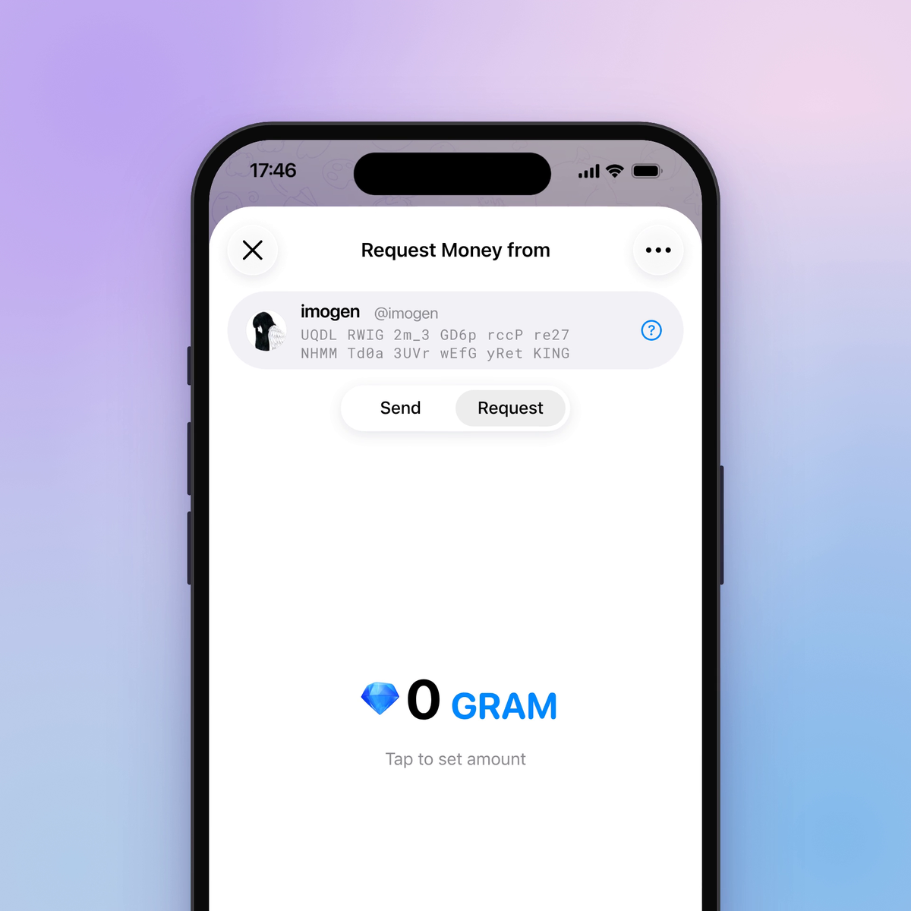
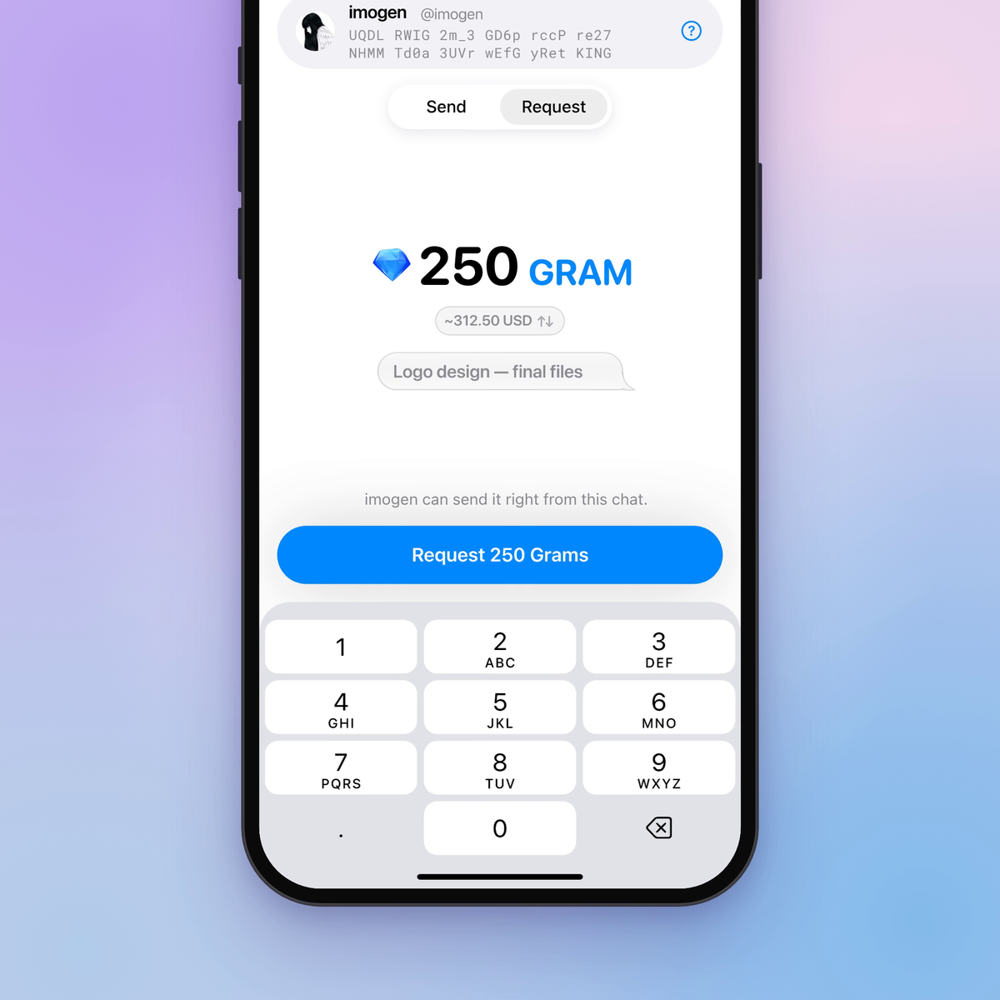
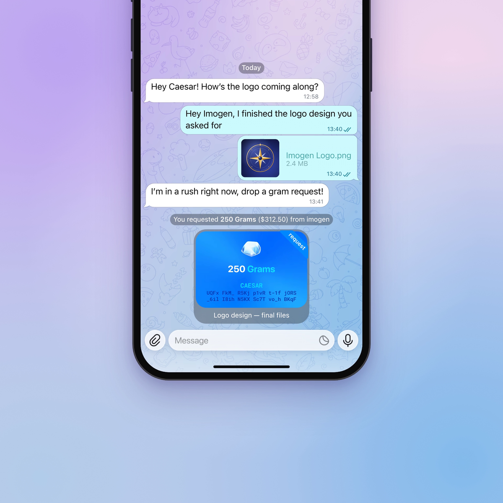
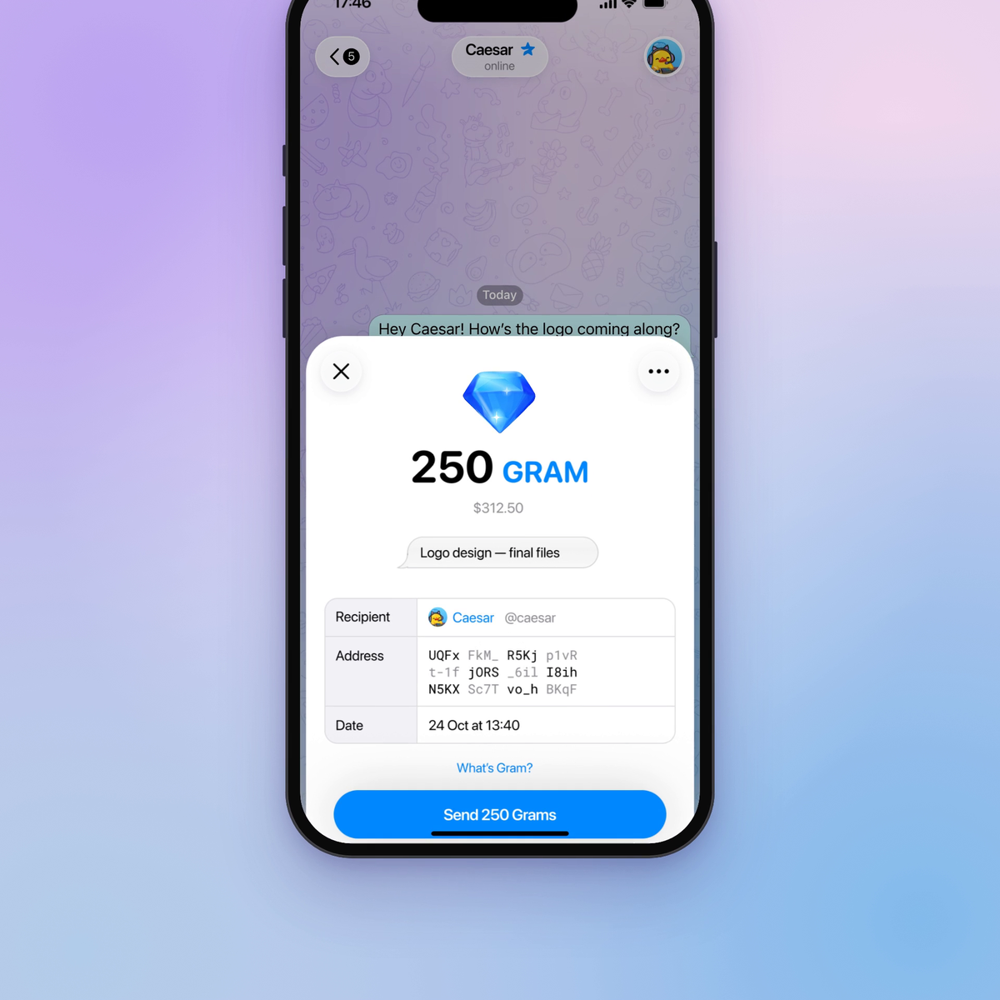
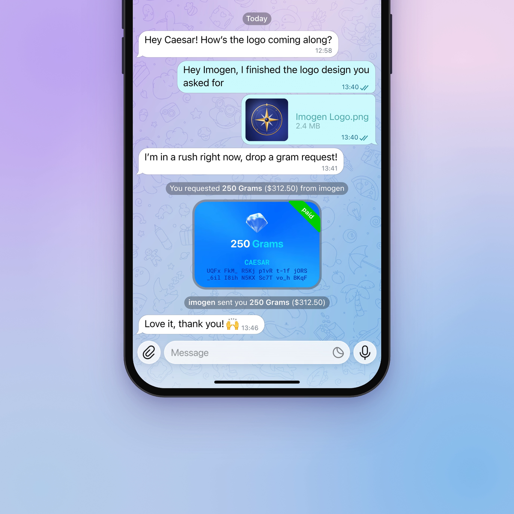

# Request GRAM for Telegram iOS

In a private chat, ask the other person for GRAM. The request arrives as the familiar blue transfer card in a **request**
state. They tap it, check who is asking, and pay with one tap plus Face ID, Touch ID or the passcode. The same card then turns
green (**paid**) in place, and a small grey line confirms the payment. No second transfer card is posted.



This is an unofficial change to the open-source [Telegram-iOS](https://github.com/TelegramMessenger/Telegram-iOS) client. It is not
affiliated with Telegram.

**Demo video:** [`demo.mp4`](demo.mp4) (30 s). Designed in Figma, animated in code.

## What it does

### 1. Send | Request

📎 → **Money** opens the usual sheet. A **Send | Request** switch sits under the recipient card. In Request mode the title reads
*Request Money from*, and the balance, fee and deposit are hidden.

### 2. Set the amount

The same keypad, animated amount, fiat pill and comment as Send. The button reads **Request 250 Grams**. The line above it says
*imogen can send it right from this chat.* and how many requests are left today, or why a request isn't possible.



### 3. Request sent

The amount's gem spins and flies out of the sheet into the new card, with the same parabola, impact and haptics as a sent transfer.
The card shows a blue `request` ribbon, the requester's name and address, and the comment. The line above reads
*You requested **250 Grams** ($312.50) from imogen*.



### 4. The other person gets it

The card arrives like a received transfer: it rises, the gem lands and the blue ribbon grows out of the corner. The line above reads
***Caesar** requested **250 Grams** ($312.50)*.

### 5. Pay from the card

Tapping the card opens a details sheet: gem, amount, fiat value, comment, **Recipient** (avatar, name and @username), **Address**,
**Date**, any warnings, *What's Gram?*, and **Send 250 Grams**.



Up to three warnings appear above the button: *Username changed in the last 7 days*, *You haven't messaged this person before*,
*Not in your contacts*.

### 6. Paid

The same card morphs its ribbon to green `paid` with a glint, a spin of the card and haptics, and the comment goes away. A grey line
confirms it: *You sent Caesar **250 Grams** ($312.50)* on one side, ***imogen** sent you **250 Grams** ($312.50)* on the other.



The payment then shows in Money as an ordinary outgoing transfer.


### 7. Cancel, decline, expire

- The requester can cancel from the card's long-press menu (**Cancel Request**). The payer can **Decline**. Both ask first.
- Cancelled, declined and expired cards turn grey, with a grey ribbon reading `cancelled`, `declined` or `expired`.

### 8. Safety

- The first request someone receives opens a short safety sheet first, with **Got It** and **Turn Off Requests**.
- **Privacy and Security ▸ Request GRAM**: Everybody · Premium Users (default) · My Contacts · Nobody, plus Always Allow and Never
  Allow lists.

Safety tips shown in the app:

- Always check the @username on the request before you send. Scammers copy names and profile photos, but they can't copy a username.
- Only pay people you know. Look back through your chat: is this really them, and did you expect this request?
- Ignore requests you didn't expect, even small ones. You can decline them, and nothing is ever sent without your Face ID or passkey.
- Holding a lot of GRAM? Turn on paid messages (Stars) so strangers can't request from you, or set "Who can request GRAM from me"
  to My Contacts.
- Telegram will never send you a GRAM request.

## How it works

- **Paying a request is its own call, `wallet.payGramRequest`**, not a flag on `wallet.sendTransfer`. A new field would change
  `sendTransfer`'s TL id and break every ordinary transfer against a server that does not know it.
- **The payment is built from the server's record** (`wallet.getGramRequest`), never from the message, so a tampered message cannot
  change the amount or the address.
- **A request payment posts no local transfer card.** The request card itself becomes the paid card.
- **The requester's gem flight** is keyed by the new request message's id, which `wallet.requestGram` now returns (read from the
  `updateMessageID` that carries the call's `random_id`).
- **The payer's arrival animation** has its own flag, `playsArrivalAnimation`, so `isIncomingTransfer` keeps meaning "received money".
- **The service lines** follow the transfer card's own `walletTransferServiceMessageString`: Semibold 13 for the amount, and for the
  other person's name only on the receiving side.
- **The privacy key is fetched in its own request**, because the other privacy keys share one `combineLatest` that fails as a whole.

The full write-up (flow, proposed TL with ids, server contract, tests, open items) is in [`docs/request-gram.md`](docs/request-gram.md).

## What the server needs

Draft TL methods and constructors (ids in [`docs/request-gram.md`](docs/request-gram.md)):

| Name | Purpose |
|---|---|
| `wallet.requestGram` | Create a request in a private chat; returns the updates with the new message |
| `wallet.getGramRequestEligibility` | Whether a request is possible now, and why not |
| `wallet.getGramRequest` | The server's record of a request, used to build the payment |
| `wallet.payGramRequest` | Pay a request |
| `wallet.cancelGramRequest` / `wallet.declineGramRequest` | Cancel or decline |
| `messageActionGramRequest` / `messageActionGramRequestPaid` | The request card and its paid state |
| `updateGramRequestStatus` | Status changes delivered to both sides |
| `GramRequests` privacy key | Who can request GRAM from me |

Every limit (username, account age, daily limit, one pending request per chat, expiry, privacy, paid messages) is enforced by the
server. The app only mirrors them to explain a refusal.

## Status

Written, not yet built. The full `Make.py` build needs Xcode and the codesigning setup, which were not available. Every Swift file
the patch touches parses; every localized string, type, function and module it uses exists; and every new `import` is a dependency
of its target. Type checking and a run in the simulator are still to do, so expect a few small compile fixes on the first build.
The feature also needs the server methods above before a request can actually be sent.

New unit tests: `GramRequestTests` (the created-message lookup) and `WalletGramRequestTests` (the flight id round trip).

## Applying the change

`changes.patch` is the difference from the official Telegram-iOS master at commit `fb0e62ba8a`. From a checkout of that commit:

```
git apply --check changes.patch
git apply changes.patch
```

Then build as described in the Telegram-iOS README. The feature is off until the app config sets `gram_requests_enabled`, or
Debug Settings ▸ **Request GRAM** is turned on. The patch touches 54 files: the Money sheet (`WalletSendScreen`), the transfer card
(`ChatMessageTransferBubbleContentNode`), the transfer flight (`ChatWalletTransferAnimation`), the chat history list, TelegramCore's
wallet API, the privacy settings and `Localizable.strings` (67 new keys), and adds `WalletGramRequestScreen` and `docs/request-gram.md`.
